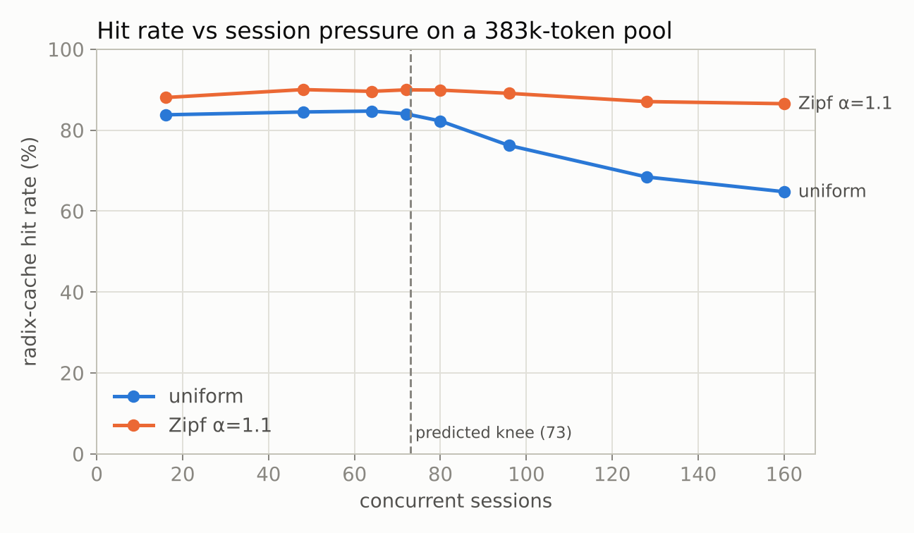
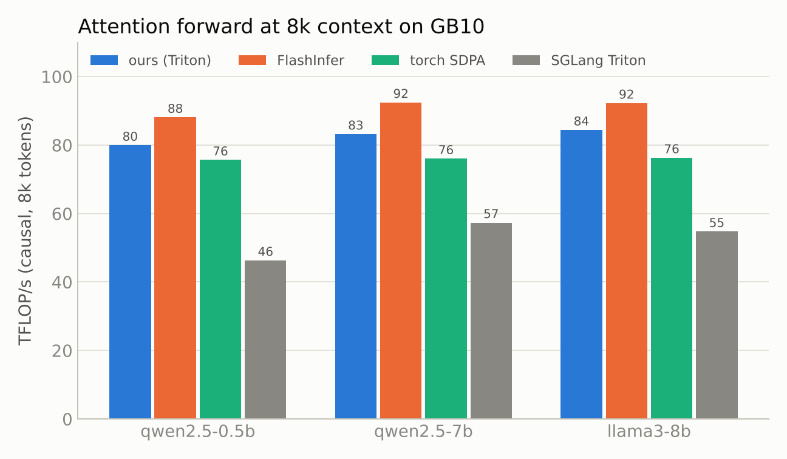
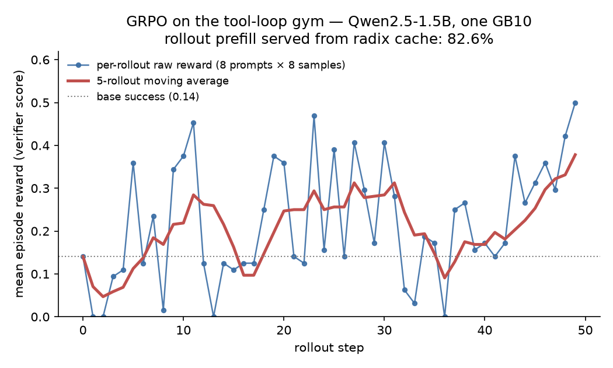

# spark-inference-lab

Three systems experiments on one NVIDIA DGX Spark (GB10, 128 GB unified memory), done over summer 2026: LLM serving, GPU kernels, and agentic RL. They share one benchmarking module, so every result is measured the same way and saved with a record of the environment that produced it.

| | Project | Question | Result |
|---|---|---|---|
| 1 | [Prefix caching for agents](writeups/p1_prefix_caching.md) | What is prefix caching actually worth for tool-calling agents? | Saves ~84% of prefill work and cuts p50 TTFT ~3.6×. The point where it starts to fail was predicted (73 sessions) before measuring it (72–80). |
| 2 | [FlashAttention in Triton](writeups/p2_flash_attention.md) | How close can a hand-written Triton kernel get to production attention on GB10? | Faster than torch SDPA at every shape tested, 8–10% behind FlashInfer at 8k after a profiling-driven rewrite (was ~20%). |
| 3 | [Tool-Loop Gym](writeups/p3_tool_loop_gym.md) | Can the full agentic-RL loop run on one Spark, and what does caching save during training? | 50-step GRPO run on Qwen2.5-1.5B: mean reward 0.14 → 0.30 (first vs last 10 steps); 82.6% of rollout prompt tokens came from the cache. |

The writeups are the main thing to read. Each one has the setup, results, what went wrong along the way, and caveats.

A note on numbers: the Spark's memory bandwidth (~273 GB/s) is about 30× lower than datacenter GPUs, so ratios and trends should carry over to bigger hardware but absolute times won't.

| | |
|---|---|
|  |  |
|  |  |

## Repo layout

```
writeups/        one writeup per project, plus figures
src/sparklab/
  bench/         shared: percentile timing, run manifests (versions, GPU, args, seeds)
  p1/            trace generator, SGLang client, caching experiments
  p2/            Triton kernels (online softmax, FlashAttention fwd), reference, benchmark
  p3/            tool environment, task templates + verifiers, base eval, miles integration
  ui/            small web UI for sending prompts and seeing TTFT + cache stats
tests/           pytest; GPU- and server-dependent tests skip when not available
runs/            raw results for every experiment (see runs/README.md)
scripts/         make_figs.py (all figures from runs/), GRPO launch + stats extraction
configs/         SGLang server launch script
deploy/          systemd units and the Prometheus/Grafana/Alertmanager stack
```

## Setup

Any machine (no GPU needed for the tests that don't touch the server or kernels):

```bash
git clone https://github.com/layahaasini/spark-inference-lab && cd spark-inference-lab
python3 -m venv .venv && .venv/bin/pip install -e ".[dev,ui]"
.venv/bin/python -m pytest -q
.venv/bin/python scripts/make_figs.py     # rebuild every figure from runs/
```

On the Spark (or any arm64 box with NVIDIA Docker), start the server and run the experiments:

```bash
bash configs/spark_server.sh                          # SGLang in NVIDIA's NGC container
python -m sparklab.p1.experiments.prefix_hit          # P1 sanity check
python -m sparklab.p1.experiments.pressure            # P1 sweep
python -m sparklab.p3.eval_base --episodes 20         # P3 base-model eval
```

P2 runs inside a container with Triton, and P3 training runs inside the miles container. The exact commands are in each project's README: [P1](src/sparklab/p1/README.md) · [P2](src/sparklab/p2/README.md) · [P3](src/sparklab/p3/README.md).

## Running it as a service (optional)

For the long P1 measurement runs I ran the server as a systemd service with monitoring, so that a crash or restart (which wipes the cache and invalidates a measurement) would be logged and alerted on.

```bash
mkdir -p ~/.config/systemd/user ~/.config/sparklab
cp deploy/*.service ~/.config/systemd/user/
systemctl --user daemon-reload && systemctl --user enable --now sparklab-server sparklab-ui
(cd deploy/monitoring && docker compose up -d)        # Prometheus, Alertmanager, Grafana
```

- Server settings (`MODEL`, `PORT`, `MEM_FRAC`, `IMAGE`) go in `~/.config/sparklab/server.env`.
- Everything listens on localhost only. From another machine: `ssh -L 8080:localhost:8080 -L 3001:localhost:3000 <spark-host>`, then the UI is at http://localhost:8080 and Grafana at http://localhost:3001/d/sparklab.
- Five alert rules: server down, server restarted, low cache hit rate under load, UI down, UI mostly failing. Setting up Slack delivery is described at the top of [alertmanager.yml](deploy/monitoring/alertmanager.yml).
- Stop the UI during measurements (`systemctl --user stop sparklab-ui`), since its requests share the cache being measured.
- `make deploy` / `make status` / `make logs` run these from a dev machine over ssh (see the [Makefile](Makefile)).

CI runs the tests on Python 3.11 and 3.12 on every push. Pushing a `v*` tag builds an arm64 Docker image (NGC SGLang base + this repo) to GHCR. See the [changelog](CHANGELOG.md).
