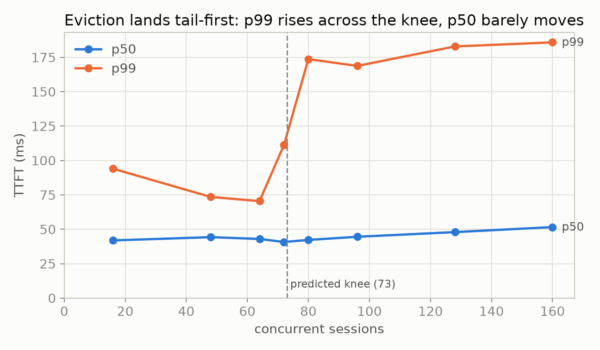

# spark-inference-lab

Systems experiments on a DGX Spark (GB10, 128 GB unified memory): inference measurement, kernels, and agentic RL. One repo, one shared benchmarking module — every result comes from the same instruments.

| # | Project | Question | Status |
|---|---------|----------|--------|
| 1 | [Prefix-caching economics](src/sparklab/p1/README.md) | What is prefix caching actually worth for tool-calling agents? | **done** — [write-up draft](writeups/p1_prefix_caching_economics.md) |
| 2 | [FlashAttention in Triton vs. the serving stack](src/sparklab/p2/README.md) | How close can a hand-written Triton kernel get to production attention on GB10, and why? | kernels built, GPU-verified — [study guide](docs/p2_reading_companion.md) |
| 3 | [Tool-Loop Gym: agentic RL on one box](src/sparklab/p3/README.md) | Does the full agentic-RL loop run on one Spark, and what does caching do to its economics? | gym + base-eval built — [study guide](docs/p3_reading_companion.md); training gated on miles |

**Reporting rule:** the Spark's 273 GB/s memory is ~30× below datacenter HBM — methodology and relative deltas transfer; absolute numbers don't.

## Repo map

```
src/sparklab/
  bench/          shared module: percentile timing, run manifests (versions/GPU/seeds per run)
  p1/             trace generator · measured client · experiments (prefix_hit, pressure)
  p2/             Triton attention kernels (online softmax, FA fwd + causal + GQA) · reference · bench
  p3/             tool-loop gym: seeded envs · state verifiers with anti-hacking tests · base-eval
  ui/             web UI: prompt box with per-request TTFT + cache stats, own /metrics
docs/             reading companions for all three projects (P1 as the original PDF)
configs/          spark_server.sh — pinned server launch (NGC container = the environment pin)
deploy/           systemd units (sparklab-server, sparklab-ui)
  monitoring/     Prometheus + Alertmanager + Grafana: 11-panel dashboard, 5 alert rules
.github/          CI (tests per push) · release-image (arm64 GHCR image per v* tag)
Dockerfile        release artifact: NGC SGLang base + this repo, one immutable image
Makefile          deploy / status / logs / test / figs
scripts/          make_figs.py — regenerates all figures from runs/*.json
tests/            40 tests; server- and GPU-gated ones skip where hardware is absent
runs/             one JSON per run, manifest embedded — source of truth for every number
writeups/         Project 1 write-up + figures
```

## Setup

**Local (any machine, no GPU):**

```bash
git clone https://github.com/layahaasini/spark-inference-lab && cd spark-inference-lab
python3 -m venv .venv && .venv/bin/pip install -e ".[dev,ui]"
.venv/bin/python -m pytest -q      # 39 pass; server- and GPU-gated tests skip
```

**Spark (or any arm64 + NVIDIA-docker box) — full bootstrap:**

```bash
mkdir -p ~/opensource && cd ~/opensource
git clone https://github.com/layahaasini/spark-inference-lab && cd spark-inference-lab
python3 -m venv --system-site-packages .venv && .venv/bin/pip install -e ".[dev,ui]"

mkdir -p ~/.config/systemd/user ~/.config/sparklab
cp deploy/*.service ~/.config/systemd/user/
systemctl --user daemon-reload && systemctl --user enable --now sparklab-server sparklab-ui
loginctl enable-linger                          # survive logout/reboot

(cd deploy/monitoring && docker compose up -d)  # metrics, dashboard, alerts

curl -sf localhost:30000/health && curl -sf -o /dev/null localhost:8080 && echo all up
```

First server start pulls the model — allow a few minutes. Server settings (`MODEL`, `PORT`, `MEM_FRAC`, `IMAGE`, `SGLANG_BASE_URL`) live in `~/.config/sparklab/server.env`, never in edited scripts. Alert delivery (Slack/email) needs one human-minted secret: recipe at the top of [alertmanager.yml](deploy/monitoring/alertmanager.yml).

## Experiments

```bash
.venv/bin/python -m sparklab.p1.experiments.prefix_hit    # sanity first: warm must be ~15× faster
.venv/bin/python -m sparklab.p1.experiments.pressure      # baseline sweep, 2–32 sessions

# the knee: shrink the pool, sweep past the predicted eviction point
echo MEM_FRAC=0.05 >> ~/.config/sparklab/server.env && systemctl --user restart sparklab-server
.venv/bin/python -m sparklab.p1.experiments.pressure --sessions 16 48 64 72 80 96 128 160

# workload shapes
.venv/bin/python -m sparklab.p1.experiments.pressure --zipf-alpha 1.1 --max-session-words 5500  # heavy-tail (cap required)
.venv/bin/python -m sparklab.p1.experiments.pressure --group-size 4                             # GRPO rollout shape

# cache-off baseline (flag passthrough needs a manual server run)
systemctl --user stop sparklab-server && bash configs/spark_server.sh --disable-radix-cache

.venv/bin/python scripts/make_figs.py     # figures, straight from runs/*.json
```

Generator knobs: `--sys-tokens` (shared prefix), `--turns` / `--tool-tokens` (growth), `--sessions`, `--zipf-alpha` (0 = uniform hard case, >0 = realistic heavy tail), `--group-size`, `--max-session-words` (context budget). Invariants — determinism, append-only growth, shared head, group sharing, caps — are pinned by tests.

Discipline baked into the harness: every sweep point starts from a flushed cache; hit rate is summed from per-request server reports (`cached_tokens`), never scraped counters; warmup exceeds `chunked_prefill_size` so one-time costs stay out of p99; each run writes its manifest beside its results. Use the server's printed `max_total_num_tokens` as pool capacity, never your own arithmetic.

## UI & dashboards

One tunnel opens everything (left-hand ports arbitrary):

```bash
ssh -L 8080:localhost:8080 -L 3001:localhost:3000 -L 9093:localhost:9093 cute-spark
```

| What | URL |
|---|---|
| Inference UI — prompt in, answer + TTFT + cache stats out | http://localhost:8080 |
| Grafana dashboard (anonymous view; `admin`/`sparklab` to edit) | http://localhost:3001/d/sparklab |
| Alertmanager — active alerts, silences | http://localhost:9093 |

To watch a request live: `journalctl --user -u sparklab-server -f` narrates each prefill batch's `#cached-token` count while the dashboard's prefill computed-vs-cached panel plots the same event.

## Operations

- **CI**: tests on Python 3.11/3.12 per push. **Releases**: a `v*` tag builds the arm64 image to GHCR — current: **v0.2.0**, `ghcr.io/layahaasini/spark-inference-lab:v0.2.0` (see [CHANGELOG](CHANGELOG.md); private repo → `docker login ghcr.io` to pull; package visibility flips with the repo).
- **Deploy**: `make deploy` — refuses a dirty tree, ships, restarts both units, gates on both health checks. `make status` / `make logs`.
- **Serving**: both units auto-restart and journal every restart with a timestamp — the audit trail that proves a measurement window was restart-free. Drilled: kill → healthy in 58 s, alert fired, journal record.
- **Alerts**: server down · server restarted (= window invalid) · low hit rate under load · UI down · UI majority-failing.
- **The one rule**: nothing upgrades and no UI traffic flows during a measurement window (`systemctl --user stop sparklab-ui` first — UI requests share the measured cache). The experiment schedule and the change schedule are one schedule.

## Results (Project 1, measured 2026-08-14)

Full narrative: **[the write-up](writeups/p1_prefix_caching_economics.md)**.

1. **The refund:** caching returns **~84% of prefill work** and ~3.6× p50 TTFT vs cache-off; ceiling case 505 → 33 ms (15.4×) on a fully shared 19.6k-token prefix.
2. **The knee is predictable:** working-set model predicted eviction onset at 73 sessions on a 383k-token pool; measured 72–80. Reproduced twice within ~1 point.
3. **Collapse is a gradual slope and lands tail-first:** 64.8% hit rate even at 2.2× oversubscription; across the knee p99 TTFT rises ~2.6× while p50 barely moves.
4. **Traffic shape is worth 22 points:** Zipf holds 86.5% where uniform falls to 64.8%; normalized, both capture ~100% of available hits below the knee.
5. **RL rollouts are the ceiling workload:** GRPO group-of-4 runs at ~96% hit rate, ~22 ms p50 — the Project 3 preview.

| | |
|---|---|
|  |  |
|  |  |

Environment for all numbers: SGLang `0.5.8+7d51a572` (NGC `26.02-py3`), driver 580.159.03, GB10, Qwen2.5-0.5B BF16. **Reproducing:** every table row traces to a `runs/*.json` whose embedded manifest records the exact environment, seeds, and args — re-run the recorded command against the recorded config and compare.
