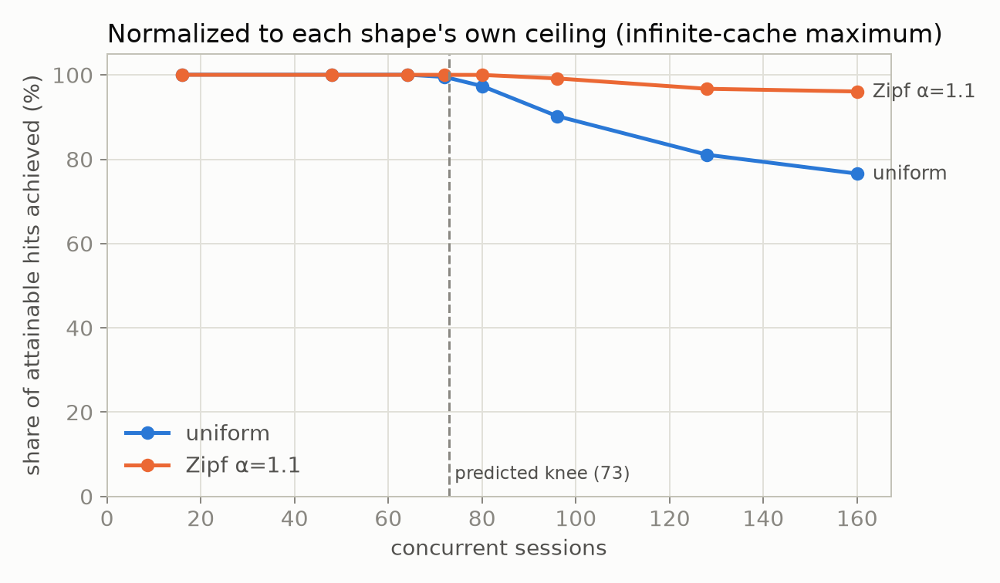
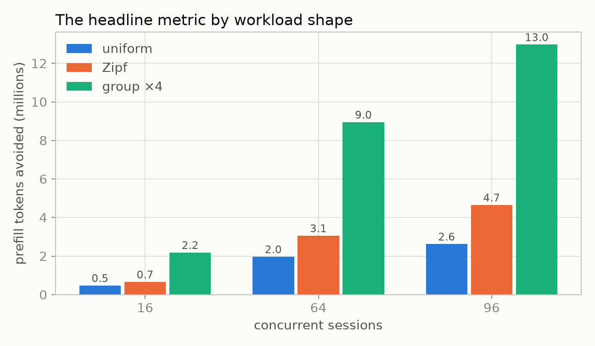

# spark-inference-lab

Systems experiments on a DGX Spark (GB10, 128 GB unified memory): inference measurement, kernels, and agentic RL. One repo, one shared benchmarking module — every experiment imports from `sparklab.bench`, so results across projects are produced by the same instruments.

| # | Project | Question | Status |
|---|---------|----------|--------|
| 1 | [Prefix-caching economics](src/sparklab/p1/README.md) | What is prefix caching actually worth for tool-calling agents? | **measurement campaign complete** — [write-up draft](writeups/p1_prefix_caching_economics.md) |
| 2 | FlashAttention in Triton vs. the serving stack | How close can a hand-written Triton FA kernel get to production attention backends on GB10, and why does the gap exist? | planned |
| 3 | Tool-Loop Gym: agentic RL on one box | Can the full agentic-RL loop run on a single Spark, and what does prefix caching do to its economics? | planned |

**Reporting rule (applies to every write-up):** the Spark's 273 GB/s LPDDR5X is roughly 30× below datacenter HBM. Methodology and relative deltas transfer to big hardware; absolute numbers do not.

---

## Repository layout

```
src/sparklab/bench/       shared benchmarking module
  timing.py                 percentile summaries (p50/p90/p99 — distributions, never bare means)
  manifest.py               run manifests: versions, GPU, clocks, seeds, pip-freeze hash,
                            sglang source commit; degrades gracefully on machines without a GPU
src/sparklab/p1/          Project 1
  tracegen.py               synthetic agentic-trace generator (see "The workload" below)
  client.py                 measured SGLang client: TTFT + the server's own cached_tokens report,
                            warmup helper, cache flush
  experiments/prefix_hit.py cold/warm sanity check — run first, always
  experiments/pressure.py   the main experiment: hit rate + TTFT vs session-count pressure
configs/spark_server.sh   pinned server launch (NGC container = the environment pin)
scripts/make_figs.py      regenerates every figure directly from runs/*.json
tests/                    15 tests; server-dependent ones skip when no server is up
runs/                     one JSON per experiment run, manifest embedded — the source of truth
                          for every published number
writeups/                 the Project 1 write-up draft + figs/
```

### The workload (what tracegen models)

Agent frameworks assemble context the same way everywhere: a large fixed system-prompt + tool-schema block starts every session (long shared prefix), each turn appends a user step and a tool result at the end and never edits above (append-only), and N sessions interleave against one cache. The generator parameterizes all of it:

| Knob | Flag | Models |
|---|---|---|
| Shared prefix size | `--sys-tokens` | the instructions+tools block every session shares |
| Turns and growth | `--turns`, `--tool-tokens MIN MAX` | per-turn appended tool results |
| Concurrency | `--sessions` | interleaved sessions competing for cache |
| Traffic skew | `--zipf-alpha` | 0 = uniform round-robin (honest hard case); >0 = heavy-tail (realistic case) |
| RL rollout shape | `--group-size` | n samples sharing one full context (GRPO) |
| Context budget | `--max-session-words` | sessions stop at a limit, like real frameworks at context_len — **required in zipf mode** |

Determinism, append-only growth, the shared head, group sharing, and the context cap are all pinned by tests. "Tokens" are whitespace words at generation time (~4.9× expansion after tokenization); every published count is the server's own tokenizer-true report at replay time.

---

## Setup

### Local development (any machine, no GPU needed)

```bash
git clone https://github.com/layahaasini/spark-inference-lab && cd spark-inference-lab
python3 -m venv .venv && .venv/bin/pip install -e ".[dev]"
.venv/bin/pytest          # 13 pass locally; 2 server-gated tests skip
```

### On the DGX Spark

SGLang runs from NVIDIA's NGC container — the image tag **is** the environment pin (bare-metal python has no sglang install; a `~/sglang` source checkout is for reading, not serving).

```bash
# one-time
mkdir -p ~/opensource && cd ~/opensource
git clone https://github.com/layahaasini/spark-inference-lab && cd spark-inference-lab
python3 -m venv --system-site-packages .venv && .venv/bin/pip install -e ".[dev]"

# requires: docker with GPU support, nvcr.io/nvidia/sglang image pulled
docker images | grep sglang   # expect nvcr.io/nvidia/sglang:26.02-py3
```

Note: with `--system-site-packages`, pip may skip installing console scripts that exist system-wide — run pytest as `.venv/bin/python -m pytest`.

---

## Running

### 1. Start the server (terminal 1)

```bash
bash configs/spark_server.sh
```

Pinned defaults: `Qwen/Qwen2.5-0.5B-Instruct`, port 30000, `--mem-fraction-static 0.70`, metrics on. Overrides via environment and passthrough args:

```bash
MEM_FRAC=0.05 bash configs/spark_server.sh                 # small KV pool → eviction pressure
bash configs/spark_server.sh --disable-radix-cache          # cache-off baseline
MODEL=Qwen/Qwen2.5-1.5B-Instruct PORT=30001 bash configs/spark_server.sh
```

On startup the server prints its computed capacity — **use this printed number**, never your own arithmetic:

```
max_total_num_tokens=7011191 ...     # at MEM_FRAC=0.70 (a ~7M-token pool: no eviction possible)
max_total_num_tokens=383544  ...     # at MEM_FRAC=0.05 (the knee-experiment pool)
```

### 2. Sanity check (terminal 2 — run before anything else)

```bash
.venv/bin/python -m sparklab.p1.experiments.prefix_hit
```

Two requests sharing a 19.6k-token prefix, after an untimed warmup request. Healthy output: warm TTFT ~15× below cold, `cached` ≈ `prompt` on the warm request. If the warm request doesn't show a large `cached_tokens`, stop — nothing downstream is worth running.

### 3. Pressure sweeps

```bash
# baseline (big pool): flat hit rate expected
.venv/bin/python -m sparklab.p1.experiments.pressure

# the knee experiment (server at MEM_FRAC=0.05):
.venv/bin/python -m sparklab.p1.experiments.pressure --sessions 16 48 64 72 80 96 128 160

# heavy-tail traffic (context cap REQUIRED or hot sessions exceed context_len):
.venv/bin/python -m sparklab.p1.experiments.pressure --sessions 16 48 64 96 160 \
    --zipf-alpha 1.1 --max-session-words 5500

# GRPO rollout shape:
.venv/bin/python -m sparklab.p1.experiments.pressure --sessions 4 16 64 96 --group-size 4
```

Each sweep point starts from a flushed cache. Every run writes `runs/pressure_<timestamp>.json` containing the full manifest (sglang version + source commit, GPU, driver, clocks, seeds, server_info, args) next to the results — a result without its manifest is unciteable.

Method notes baked into the harness: warmup exceeds `chunked_prefill_size` (8,192 tokens) because the one-time cost hides in the multi-chunk prefill path — a small warmup warms the wrong path and leaves a ~3 s ghost in the first point's p99; hit rate is summed from per-request server reports, never scraped from aggregate counters; replay is closed-loop per session by construction (an agent turn cannot exist before the previous response).

### 4. Tests

```bash
.venv/bin/python -m pytest              # generator invariants + bench module
.venv/bin/python -m pytest -m needs_server   # end-to-end checks (needs live server; SGLANG_BASE_URL to override)
```

The server-gated tests assert warm-faster-than-cold as a **ratio** (never a fixed ms number) plus the server's own cached-token report, and that a flush actually makes the next request cold.

### 5. Figures

```bash
.venv/bin/python scripts/make_figs.py   # writes writeups/figs/*.png
```

Figures are generated from `runs/*.json` (latest run per workload shape, selected by recorded args) — no hand-entered numbers anywhere. The normalized chart computes each shape's attainable maximum by infinite-cache longest-prefix simulation over the same traces.

---

## Deployment & operations

Code reaches the Spark through a versioned, repeatable path — not ad-hoc ssh:

- **CI** ([.github/workflows/ci.yml](.github/workflows/ci.yml)): tests on Python 3.11/3.12 for every push and PR. No green, no deploy.
- **Releases** ([release-image.yml](.github/workflows/release-image.yml) + [Dockerfile](Dockerfile)): pushing a `v*` tag builds an arm64 image — NGC SGLang base + this repo baked in — and publishes it to GHCR. A version tag names one immutable artifact: environment and instruments together.
- **Serving** ([deploy/sparklab-server.service](deploy/sparklab-server.service)): the server runs as a systemd user service on the Spark — survives reboots, restarts on crash, and journald records every restart *with a timestamp*. That record matters for data integrity, not just uptime: a silent restart wipes the radix cache and invalidates every measurement taken after it. Overrides (`MEM_FRAC`, `MODEL`, …) live in `~/.config/sparklab/server.env`.
- **Deploying** ([Makefile](Makefile)): `make deploy` ships the committed tree (refuses a dirty one), reinstalls, restarts the unit, and gates on the health check. `make status` / `make logs` for inspection.

**The one operational rule:** never upgrade anything — code, image, model, flags — during a measurement window. The experiment schedule and the upgrade schedule are one schedule.

---

## Results (Project 1, measured 2026-08-14)

Full narrative and figures: **[the write-up](writeups/p1_prefix_caching_economics.md)**. The five headline results:

**1. The refund.** Prefix caching refunds **~84% of all prefill work** on this trace shape and cuts p50 TTFT **~3.6×** (~134 → ~37 ms) vs `--disable-radix-cache`. The ceiling case: a cold 19.6k-token prompt takes 505 ms; its warm twin takes 33 ms — **15.4×** with 100% of the prefix served from the radix tree.

**2. The knee is predictable.** On a 383,544-token pool, the working-set model — `head + n × per-session-history = pool`, all three quantities measured — predicted eviction onset at **73 sessions**; measured onset landed at **72–80**. The sweep was run twice across separate server restarts; every hit rate reproduced within ~1 point.

**3. Collapse is a slope that lands tail-first.** At 2.2× pool oversubscription the hit rate is still 64.8% (LRU + append-only means every miss re-primes its branch). Across the knee, p99 TTFT rises ~2.6× while p50 moves ~20% — for multi-turn agents the p99 is the contract, and the knee shows up there first.

**4. Traffic shape is worth 22 points.** Under identical pressure, heavy-tail (Zipf α=1.1) traffic holds **86.5%** where uniform falls to **64.8%**. Normalized to each shape's attainable maximum: both achieve **~100% of available hits below the knee** (the raw ~84% ceiling is the workload's property, not the engine's); past it, uniform decays to 77% of attainable while Zipf holds 96%.

**5. RL rollouts are the ceiling workload.** GRPO group sampling (×4) runs at **~96% hit rate** at the lowest latency measured (~22 ms p50), avoiding 13M prefill tokens at 96 sessions — the Project 3 economics preview.

| | |
|---|---|
|  |  |
|  |  |

**Environment for all numbers:** SGLang `0.5.8+7d51a572` (NGC `nvcr.io/nvidia/sglang:26.02-py3`), driver 580.159.03, GB10, Qwen2.5-0.5B-Instruct BF16 (12 KB KV/token). Per-run manifests in `runs/`.

---

## Reproducing a published number

Every table row in the write-up traces to a JSON in `runs/`:

```bash
python3 - <<'EOF'
import json, glob
for p in sorted(glob.glob("runs/pressure_*.json")):
    d = json.load(open(p)); a = d["manifest"]["args"]
    shape = "group" if a.get("group_size",1)>1 else ("zipf" if a.get("zipf_alpha",0)>0 else "uniform")
    print(f"{p}  {shape:8s} sessions={a['sessions']}")
EOF
```

Pick the run, read `manifest` for the exact environment, re-run the command in its `args` against the same server config, compare.
