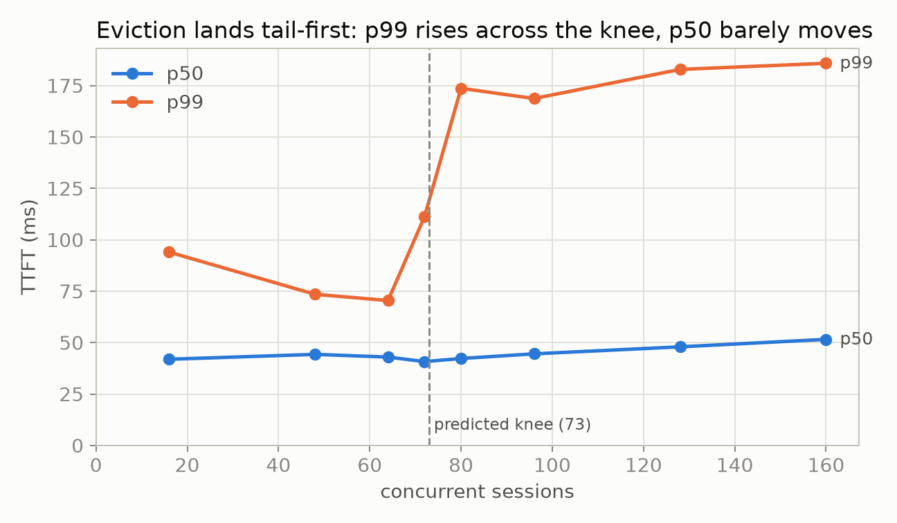
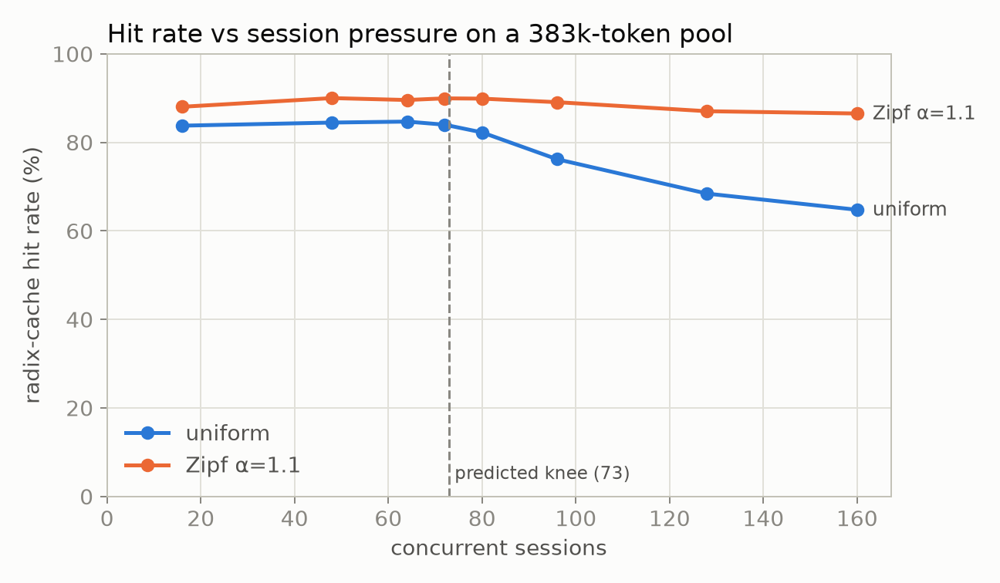
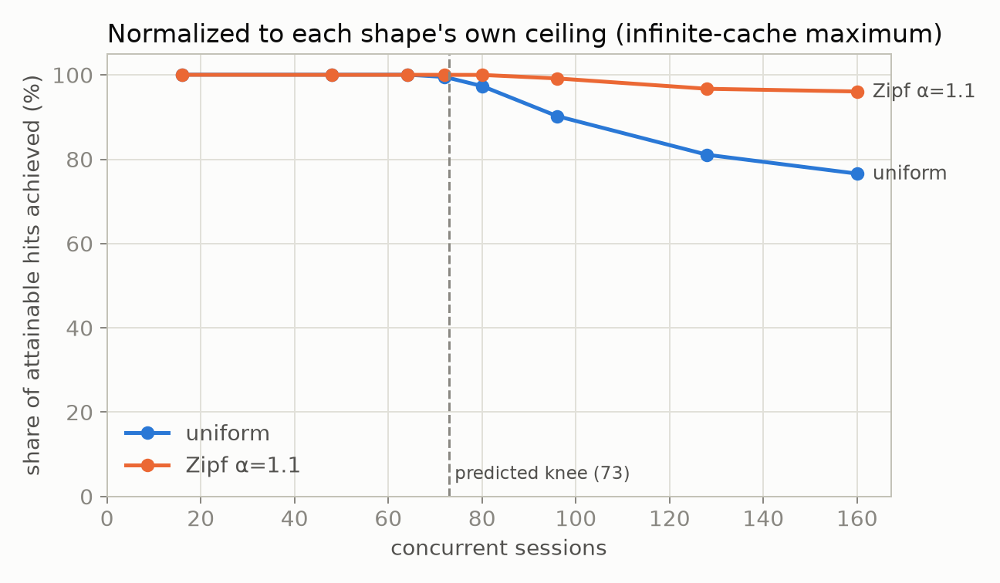
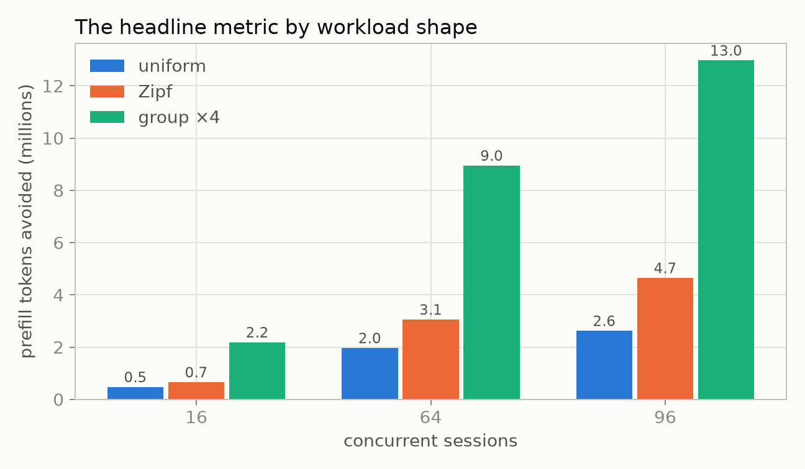

# What is prefix caching actually worth for tool-calling agents?

> **DRAFT — numbers final, prose in progress. Do not publish before the pre-publication checklist at the bottom is cleared.**

**Question:** how much does SGLang's RadixAttention actually save on realistic agentic workloads, in tokens and milliseconds?
**Method:** a parameterized synthetic-trace generator modeling how agent frameworks assemble context (long shared system prefix, append-only per-turn growth, N interleaved sessions, heavy-tail scheduling, GRPO group sampling), replayed against a pinned SGLang server on a DGX Spark — cache on vs off, eviction pressure controlled by shrinking the KV pool.
**Result:** on this workload, prefix caching refunds **~84% of all prefill work** and cuts p50 time-to-first-token ~3.6× (~134 ms → ~37 ms). The hit rate holds that ceiling until the cache working set crosses pool capacity at a knee **predictable in advance from three measured quantities** — shared-head size, per-session growth, and the server's printed pool capacity (predicted 73 sessions, observed 72–80), degrades gradually rather than falling off a cliff, and lands tail-first: p99 TTFT rises ~2.6× across the knee while p50 barely moves. Heavy-tail (Zipf) traffic holds an 86.5% hit rate under pressure that drags uniform traffic down to 64.8%, and RL-style group rollouts run at ~96% — the most cache-favorable workload there is.

## Why measure this

Every serving engine now ships prefix caching, and every agent framework produces exactly the workload it loves: a large fixed block of instructions and tool schemas at the top of every request, a conversation that only ever grows at the end, and turn after turn re-sending everything the model has already seen. The qualitative story — "caching helps agents" — is everywhere. What I could not find published: *how much*, measured, on a stated workload, with the failure boundary located. This post is that measurement.

The numbers that translate to money are **prefill tokens avoided** — every cached token is prompt-processing work the GPU never repeats — so that metric leads every table below. Commercial APIs price cached input at roughly 2–10% of the fresh-token rate (as of August 2026: Anthropic bills cache reads at ~10% of the base input price, OpenAI's cached input is 10% of the fresh rate, and DeepSeek's cache hits run ~2% of the cache-miss rate). At that spread, an 84% refund cuts effective prompt-side cost by **~76–82%**. The nonzero floor also confirms the accounting: a cache hit still pays real storage and retrieval costs, which is exactly what the hit-rate-under-pressure experiments below measure the limits of.

## Setup

| | |
|---|---|
| Hardware | NVIDIA DGX Spark: GB10 (sm_121a), 128 GB unified LPDDR5X, ~273 GB/s |
| Server | SGLang `0.5.8+7d51a572`, NGC container `nvcr.io/nvidia/sglang:26.02-py3`, driver 580.159.03 |
| Model | Qwen/Qwen2.5-0.5B-Instruct, BF16 (12 KB of KV per token) |
| Launch | `--mem-fraction-static {0.70, 0.05}` `--enable-metrics`, full flags in `configs/spark_server.sh` |
| Instruments | trace generator + measured client + sweep harness in this repo; every run writes a manifest (versions, GPU, clocks, seeds, server args) |

One sentence on scope, once, so the rest of the post doesn't have to hedge: the Spark's memory bandwidth is roughly 30× below datacenter HBM, so **methodology and relative deltas transfer to big hardware; absolute speeds and dollar figures do not.** If anything, expensive prefill relative to memory makes caching economics *more* vivid here, not less.

Ground truth discipline: every hit-rate number below is the sum of per-request `cached_tokens` / `prompt_tokens` reported by the server itself in each response's `meta_info` — never scraped from aggregate counters, never inferred from timing. Timing (TTFT percentiles, measured client-side on a streamed first chunk) is supporting evidence. Every sweep point starts from an explicitly flushed cache. Replay is closed-loop per session by construction — an agent turn cannot exist before the previous response — which is the workload's real shape, not a coordinated-omission artifact; open-loop *session arrival* is future work.

## The workload

The trace generator models what agent frameworks actually do, with each behavior a measured parameter rather than an assumption:

- **Shared head:** one fixed system-prompt + tool-schema block (~3,900 tokens here) starts every session — the same bytes, every request, forever.
- **Append-only growth:** each turn appends a user step and a tool result (~1,040 tokens/turn measured) to the end of the context and edits nothing above it. This invariant is what makes agent traffic cacheable at all, and the generator's tests pin it.
- **Interleaving:** N sessions take turns competing for one cache. Uniform round-robin is the honest hard case; Zipf-weighted scheduling (a few hot sessions dominate) is the realistic case. Both are reported.
- **Group mode:** n samples share one full context and diverge only in a small tail — the GRPO rollout shape used in RL training.
- **Context budget:** sessions stop growing at a configurable limit, the way real frameworks stop at the model's context window. (The first Zipf run taught this the hard way: the hottest session outgrew `context_len` and the server rightly refused it.)

Tokens are approximated as words at generation time; every published count is the server's own tokenizer-true report at replay time.

## Results

### 1. Cache off vs cache on: the refund

Same trace (2–32 sessions × 5 turns), same server config, one flag flipped. Three of five sweep points shown; the omitted rows (4, 16 sessions) sit between their neighbors, full data in `runs/`:

| sessions | cache-off p50 / p99 TTFT | cache-on p50 / p99 TTFT | hit rate | tokens avoided |
|---|---|---|---|---|
| 2 | 172.0 / 228.5 ms | 47.8 / 84.8 ms | 78.0% | 58,567 |
| 8 | 125.5 / 212.1 ms | 35.0 / 82.8 ms | 85.0% | 225,945 |
| 32 | 139.2 / 250.7 ms | 37.3 / 69.8 ms | 84.4% | 963,166 |

**~3.6× on p50 TTFT, ~84% of prefill work refunded.** Both lines are flat in session count — correctly so, since below cache capacity neither depends on concurrency. The ~84% is this trace shape's *attainable maximum*, not a deficiency: each turn's freshly appended tool result is new to the world and must be prefilled once; only the shared head and prior history can ever hit. The single-prefix ceiling case: a cold 19.6k-token prompt takes 505 ms; its warm twin, 100% served from the radix tree, takes 33 ms — **15.4×** on the request that shares everything.

### 2. The knee: predicting where caching stops working

Shrink the pool to force the interesting regime: at `--mem-fraction-static 0.05` the server reports a **383,544-token** KV pool at startup (the server's printed capacity, not my arithmetic). The working-set model says the cache is full when

```
shared head + sessions × per-session history  =  pool
3,900      + n × 5,200                        =  383,544   →   n ≈ 73
```

— both trace parameters measured from the baseline run, prediction written down before the sweep ran. Measured, uniform scheduling:

| sessions | p50 TTFT | p99 TTFT | hit rate | tokens avoided |
|---|---|---|---|---|
| 48 | 44.3 ms | 73.5 ms | 84.5% | 1,485,693 |
| 64 | 43.0 ms | 70.5 ms | 84.7% | 1,970,842 |
| 72 | 40.8 ms | 111.2 ms | 84.0% | 2,199,552 |
| 80 | 42.3 ms | 173.7 ms | 82.3% | 2,363,843 |
| 96 | 44.5 ms | 168.7 ms | 76.2% | 2,629,903 |
| 128 | 47.9 ms | 182.9 ms | 68.4% | 3,207,076 |
| 160 | 51.6 ms | 185.9 ms | 64.8% | 3,733,953 |

Ceiling through 64, first crack at 72–80, prediction validated within ~10%. This sweep was run twice — before and after the warmup fix, on separate server restarts — and every hit rate reproduces within about a point. Two properties of the collapse matter more than its location:

- **It is a slope, not a cliff.** Even at 160 sessions — working set 2.2× the pool — the hit rate is 64.8%, not 6%. Under LRU with append-only growth, every miss immediately re-primes the evicted branch, which then survives long enough to serve the session's next turns. Eviction and reuse reach a moving equilibrium instead of thrashing to zero.
- **It lands tail-first.** Across the knee, p99 TTFT rises ~2.6× (70 → 186 ms) while p50 moves ~20%. Most requests still hit; the unlucky ones pay full re-prefill. An agent that runs ten sequential turns samples the tail with probability ~1 − 0.99¹⁰ ≈ 10% — for agents, **the p99 is the contract**, and the knee shows up there first.



### 3. Traffic shape: the honest case vs the realistic case

Same pool, same session counts, Zipf-weighted scheduling (α = 1.1, context-capped):

| sessions | uniform hit | Zipf hit | Zipf tokens avoided |
|---|---|---|---|
| 64 | 84.7% | 89.6% | 3,062,019 |
| 96 | 76.2% | 89.1% | 4,651,994 |
| 160 | **64.8%** | **86.5%** | 7,641,090 |



At maximum pressure, heavy-tail traffic holds a **22-point hit-rate advantage**. The mechanism is classical cache theory landing exactly as predicted: LRU keeps hot sessions resident, hot sessions carry most of the traffic, and evictions concentrate on cold sessions nobody revisits. Real agent fleets are heavy-tailed, so uniform-traffic benchmarks — including most published ones — *understate* what prefix caching is worth in production.

Because capped Zipf sessions grow longer than uniform ones, the two curves have different attainable maxima, so the fair comparison normalizes each to its own infinite-cache ceiling (computed by longest-prefix simulation over the same traces):



Two things fall out of the normalized view. Below the knee, both shapes sit at ~100% — RadixAttention captures essentially **every hit the workload makes available**, so the raw ~84% ceiling was the trace's property, not the engine's. Past the knee, uniform traffic decays to 77% of attainable at 160 sessions while Zipf holds 96%: the entire collapse is an eviction story, and popularity skew is what shields against it.

### 4. Group rollouts: the RL preview

GRPO-style group sampling — 4 samples sharing each context, diverging only at the tail:

| sessions | p50 TTFT | hit rate | tokens avoided |
|---|---|---|---|
| 16 | 22.1 ms | 95.9% | 2,191,284 |
| 64 | 25.5 ms | 96.1% | 8,953,955 |
| 96 | 21.8 ms | 93.9% | **12,976,262** |



*(Bar totals are not cross-shape comparable in absolute terms — Zipf traces carry longer sessions and group mode sends 4× the requests; the refund share, not the total, is the comparable number.)*

**~96% hit rate at the lowest latency of any workload measured** — three of every four requests replay a context the first sample just primed. This is the shape RL training produces during rollouts, and it means the rollout phase of multi-turn RL is nearly free on the prompt side when the cache is sized right. Measuring this *inside* an actual training run is the bridge experiment of Project 3.

## What this means for capacity

The standard capacity identity: if prefill is a fraction *f* of serving work and *h* of it is refunded, sustainable traffic multiplies by 1 / (1 − f·h). At the measured h ≈ 0.84 and a Mooncake-typical f ≈ 0.55, that projects **~1.86× more traffic on the same hardware** — before counting the queueing bonus (Little's law: shorter requests → fewer in flight → less waiting near saturation, so the delivered improvement exceeds the time saving alone). *f* was not measured in this campaign; validating the projection against goodput-under-SLO curves is listed as future work, and the formula's breakdown condition (f·h → 1) is nowhere near this regime.

## Honesty section: what these numbers are not

- **The first number I got was wrong, and the cache-off baseline caught it.** My cold/warm sanity check initially showed a 123× TTFT ratio (3.8 s cold). The cache-off sweep then showed full re-prefill of mid-size contexts costs ~140 ms — so a 19.6k-token prefill cannot legitimately cost 3.8 s. That first-ever request had absorbed one-time server warmup. Re-measured with warmup excluded, the same prompt is 505 ms cold / 33 ms warm: **15.4×, not 123×.** Running the weakened-baseline check from Heiser's measurement-crimes list is the only reason the wrong number didn't ship.
- **The warmup itself took two attempts to get right.** A tiny warmup request did not clear the artifact; neither did a mid-size one. The one-time cost hides in the chunked-prefill code path, which only engages above 8,192 prompt tokens — so a warmup that stays below the chunking threshold warms the wrong path. The harness now warms up past `chunked_prefill_size`, and every first-point p99 in the tables above is clean. (General lesson: warm up through the *same code paths* the measurement will take, not just the same endpoint.)
- **Absolute numbers stay home.** Ratios, curve shapes, the knee-prediction method, and the traffic-shape gap transfer; milliseconds and dollars from a 273 GB/s single node do not.
- **One replay per sweep point, no formal error bars.** Each point is a single full-trace replay (60–800 requests, so per-point percentiles are well-populated, but point-to-point variability is only bounded empirically: the knee sweep run twice across separate server restarts reproduced every hit rate within ~1 point). Bootstrap confidence intervals on the percentiles are queued for the final charts.
- **One model, one engine, serial replay.** 0.5B-class model, SGLang only, one request in flight (the per-session closed loop is real; fleet-level concurrent arrivals are not modeled). vLLM's block-hash design would show the same shape with coarser matching granularity — measuring that is the obvious cross-engine follow-up.

## Reproducing

Every table row traces to a JSON in `runs/` carrying its full manifest (software versions, GPU, clocks, seeds, server args, environment hash). The repo's tests pin the generator's invariants — determinism, append-only growth, shared head, group sharing, context caps — plus two server-gated end-to-end checks. One server flag, one command per experiment:

```bash
bash configs/spark_server.sh                    # add --disable-radix-cache for the off baseline
python -m sparklab.p1.experiments.pressure --sessions 16 48 64 72 80 96 128 160
```

## Pre-publication checklist

- [x] Fix warmup to exceed `chunked_prefill_size`; re-run affected sweeps; remove † markers
- [x] Re-run cold/warm sanity check post-warmup-fix; quote the honest ratio (505 ms / 33 ms = 15.4×)
- [x] Charts: hit-rate-vs-sessions (uniform + Zipf + predicted-knee line), TTFT p50/p99 pair, tokens-avoided bars — generated from run JSONs by `scripts/make_figs.py`
- [x] Normalize uniform/Zipf curves to per-shape attainable maxima — infinite-cache simulation in `scripts/make_figs.py`; below the knee both shapes achieve ~100% of attainable
- [x] Re-check cached-token pricing pages; date the citation (August 2026: Anthropic ~10%, OpenAI 10%, DeepSeek ~2% — re-verify at publication)
- [x] Every chart re-checked against the measurement-crimes list — zero-based axes throughout; cache-off baseline present; distributions not means; configs disclosed in Setup + manifests; cross-shape comparability caveated and normalized; omitted table rows disclosed; run-to-run variability stated in Honesty section
- [x] Final pass: every headline claim appears as a plain quotable sentence (refund, TTFT ratio, ceiling case, knee prediction, slope-not-cliff, tail-first, Zipf gap, normalized ~100%, group ~96%, capacity projection flagged as projection)
