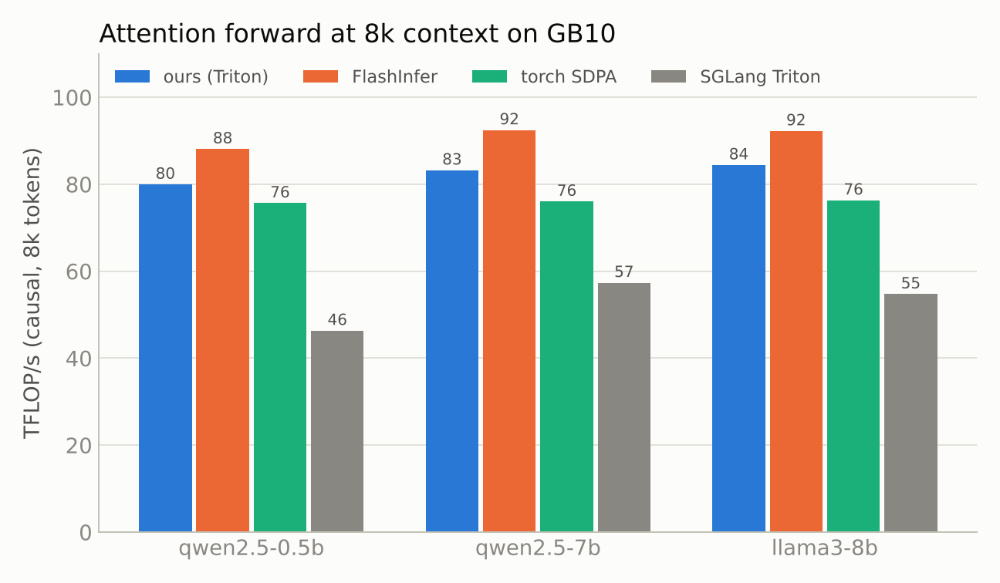

# FlashAttention in Triton on a DGX Spark: how close can a hand-written kernel get?

*Project 2 of [spark-inference-lab](../README.md) · measured August 2026*

**Question:** how close can a FlashAttention forward kernel written in Triton get to the attention backends a serving stack actually uses on GB10, and where does the remaining gap come from?
**Method:** build up from online softmax to a causal, GQA-aware FlashAttention forward kernel; check every variant against an FP32 reference at explicit BF16 tolerances; benchmark against naive attention, torch SDPA, FlashInfer and SGLang's Triton backend on real model shapes; profile with Nsight Compute, change the kernel based on what it shows, and measure again.
**Result:** the final kernel runs at **80–84 TFLOP/s at 8k context**, faster than torch SDPA at every shape and length tested (+6–11% at 8k, up to 2× at 512) and **8–10% behind FlashInfer** at 8k. Before the profiling-driven changes it was ~20% behind FlashInfer, so about half of that gap was closed.



## Setup

| | |
|---|---|
| Hardware | NVIDIA DGX Spark: GB10 (sm_121a), 128 GB unified LPDDR5X, ~273 GB/s |
| Software | NGC SGLang container (torch `2.11.0a0`, Triton 3.5.1, FlashInfer 0.6.1) |
| Shapes | Qwen2.5-0.5B (14 Q heads / 2 KV heads, head_dim 64), Qwen2.5-7B (28/4, 128), Llama-3-8B (32/8, 128) |
| Lengths | 512, 2048, 8192 tokens, causal, batch 1, BF16 |
| Timing | `triton.testing.do_bench` (warmup + repeated runs) |

FLOPs are counted as 4·B·H·N²·D, halved for causal. Naive attention is skipped past 2k because it builds the full N×N score matrix.

## The kernel

The code is in [`src/sparklab/p2/kernels/`](../src/sparklab/p2/kernels/). It was built in steps, each one tested before the next:

1. **Online softmax** (`online_softmax.py`): softmax over a row in blocks, keeping only a running max and running sum. When a new block has a larger max, the old sum is rescaled. This is the trick FlashAttention relies on.
2. **FlashAttention forward** (`flash_attn.py`): each program takes a block of query rows, loops over key/value tiles, and folds each tile into a running output using the same rescale. The N×N score matrix is never written to memory.
3. **Causal masking**: the key loop stops at the diagonal, so causal attention does about half the work.
4. **GQA**: several query heads share one KV head. In the kernel this is one line, `h_kv = h // KV_GROUPS`.

Correctness tests (`tests/test_p2_kernels.py`) compare against an FP32 naive reference with atol = rtol = 2e-2, using lengths that don't divide evenly into blocks (e.g. 500) and the real GQA ratios. All 9 pass before any benchmark is run.

## First benchmark

The first version was faster than SDPA at short lengths but ~5% slower at 8k (72–74 vs 76–78 TFLOP/s). Adding FlashInfer showed the real target: **88–93 TFLOP/s at 8k, about 20% ahead of my kernel**.

## Profiling: why it was slower

Nsight Compute on the Qwen2.5-7B shape at 8k ([`runs/p2/ncu_fa_8k.txt`](../runs/p2/ncu_fa_8k.txt)):

- registers limited each SM to 2 blocks, so **theoretical occupancy was 16.7%** (achieved 16.5%)
- compute and memory throughput were both only around 50% of peak
- no register spills

So the kernel was not limited by bandwidth. It was latency-bound: too few warps were resident to hide memory and instruction latency, because each thread used too many registers.

## What I tried

| attempt | change | 8k result |
|---|---|---|
| tuning round 1 | more warps, more pipeline stages in the autotune configs | +10% at 2k on the 0.5B shape; no change at 8k (8-warp configs spilled) |
| tuning round 2 | smaller `BLOCK_M` to shrink the accumulator | no change: most registers go to Triton's pipelining, not the accumulator |
| **restructure** | split loop + base-2 softmax (below) | **72–74 → 80–84 TFLOP/s** |

The two changes in the restructure are both things the production kernels do:

- **Split key loop.** With causal masking, only the tiles on the diagonal need masking. The loop now runs in two parts: an unmasked part for tiles that are fully visible (no comparisons, no load masks), then a short masked part for the diagonal and any ragged tail. At 8k, about 95% of tiles take the unmasked path.
- **Base-2 softmax.** `exp(x)` is replaced with `exp2(x · log2 e)`, with `log2 e` folded into the softmax scale. The math is the same, and the GPU computes `exp2` natively.

## Results

Final run ([`runs/p2/attn_bench_2026-08-19T20-40-39.json`](../runs/p2/attn_bench_2026-08-19T20-40-39.json)), TFLOP/s, causal:

| shape | N | ours | FlashInfer | torch SDPA | SGLang Triton | naive |
|---|---|---|---|---|---|---|
| Qwen2.5-0.5B | 512 | **18.1** | 14.7 | 9.0 | 7.4 | 0.9 |
| | 2048 | **59.1** | 54.4 | 39.2 | 29.1 | 0.7 |
| | 8192 | 80.0 | **88.1** | 75.7 | 46.3 | — |
| Qwen2.5-7B | 512 | 23.9 | **25.7** | 15.9 | 18.5 | 1.2 |
| | 2048 | 66.7 | **74.3** | 47.5 | 46.4 | 1.3 |
| | 8192 | 83.2 | **92.5** | 76.0 | 57.4 | — |
| Llama-3-8B | 512 | 23.9 | **26.4** | 16.2 | 20.1 | 1.2 |
| | 2048 | 67.8 | **72.7** | 49.8 | 47.8 | 1.3 |
| | 8192 | 84.4 | **92.3** | 76.3 | 54.7 | — |

- Faster than torch SDPA everywhere, and 1.2–2.5× faster than SGLang's Triton prefill backend.
- On the small 0.5B shape (head_dim 64) it beats FlashInfer at 512 and 2048.
- At 8k it is 8–10% behind FlashInfer on all three shapes.
- At 2k, naive attention is 35–85× slower than the fused kernels. That is the cost of writing the full score matrix to memory and reading it back.

## Where the remaining gap is

After the restructure, the remaining 8–10% at long context is most likely the kind of thing Triton doesn't give direct control over on sm_121a: warp-specialized pipelines where some warps only load data (with TMA) while others only compute. FlashInfer and FlashAttention-3 use this. I didn't test that directly, so treat it as the likely explanation, not a measured one.

## Caveats

- **Forward pass only**, no backward, no paged KV cache, no variable-length batching. FlashInfer's single-prefill call was used to match that setup.
- **One machine.** GB10 memory is ~30× slower than datacenter HBM. The ranking and the ratios are what I'd expect to carry over, not the absolute TFLOP/s.
- **One run per configuration** for the final table. Across the repeated runs during tuning, the same kernel at 8k varied by up to ~1.5 TFLOP/s.
- The kernel uses no NVIDIA-specific intrinsics, so it should also compile for AMD GPUs through Triton, but I haven't run it on one.

## Reproducing

Inside the NGC PyTorch or SGLang container on the Spark (FlashInfer and SGLang legs need the SGLang container):

```bash
python -m pytest tests/test_p2_kernels.py -q        # correctness first
python -m sparklab.p2.bench_attn --causal            # writes runs/p2/attn_bench_<timestamp>.json
python -m sparklab.p2.profile_attn --impl ours       # small repro to run under ncu
```

The full `docker run` lines are in [`src/sparklab/p2/README.md`](../src/sparklab/p2/README.md).
