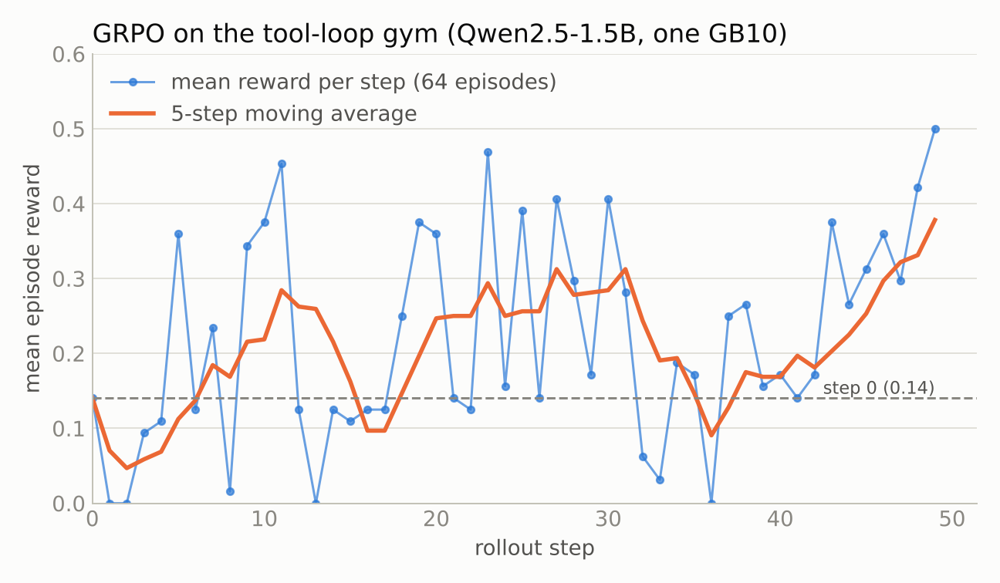

# Tool-Loop Gym: agentic RL on one DGX Spark

*Project 3 of [spark-inference-lab](../README.md) · measured August 2026*

**Question:** can the whole agentic-RL loop (environment, verifier, SGLang rollouts, GRPO updates) run on a single DGX Spark, and how much of the rollout prompt work does prefix caching save during real training?
**Method:** a small key-value-store environment with six seeded task templates, verifiers that check the final state (never the model's text), a known cheat per template that must score 0, a base-model eval to pick tasks the model can learn from, then GRPO with [miles](https://github.com/radixark/miles) and SGLang rollouts, with the Project 1 cache accounting running inside the rollout function.
**Result:** a 50-step GRPO run of Qwen2.5-1.5B (full fine-tune) ran end to end on one GB10. Mean reward went from **0.14 over the first 10 steps to 0.30 over the last 10** (0.38 over the last 5), with no collapse at lr 1e-6. **82.6% of all rollout prompt tokens were served from SGLang's prefix cache** (2.57M of 3.11M tokens over 3,200 episodes).



## The environment

The code is in [`src/sparklab/p3/`](../src/sparklab/p3/).

- **`env.py`**: a key-value store with five tools: `read`, `write`, `incr`, `delete`, `keys`. Initial state is seeded. Bad tool calls return an error string instead of raising, so a confused model just ends up with a bad episode.
- **`tasks.py`**: six templates on three difficulty levels:

| template | difficulty | goal |
|---|---|---|
| `write_constant` | 1 | set key X to V |
| `copy_value` | 2 | copy the value at A into B |
| `increment_counter` | 2 | increase A by N |
| `sum_two_keys` | 3 | write A + B into C |
| `largest_key` | 3 | find the largest value and write it into C |
| `cleanup_threshold` | 3 | delete every key above a threshold, leave the rest |

Three rules for every template:

1. **Reward comes from state.** `verify()` checks the store after the episode. What the model says doesn't matter.
2. **Nothing else may change.** `verify()` also checks that unrelated keys are untouched. Otherwise "delete everything, then write the answer" would pass some tasks.
3. **Each template has a cheat that must fail.** `lucky_guess()` is a shortcut a policy might find (guessing a common number, deleting every key). `tests/test_p3_tasks.py` checks every cheat scores 0 and every honest solution scores 1.

Transcripts are append-only: a fixed system + tool block, then each turn adds the model's call and the tool result at the end. That is the same shape as the Project 1 traces, so rollouts should cache well.

## Picking tasks before training

GRPO compares the rewards inside a group of samples for the same prompt. If all 8 samples fail (or all succeed), every advantage is 0 and that group teaches nothing. So before training, `eval_base.py` runs each template 20 times against the base model and keeps tasks with roughly 10–60% success.

This took three rounds with Qwen2.5-1.5B-Instruct, and the first two found bugs in my harness, not the model:

| round | change | result |
|---|---|---|
| 1 | raw text prompts | 0% on every task, including the one-write task |
| 2 | use the model's chat template | still 0%: the model made correct calls in slightly different formats (`WRITE {...}`) that my parser rejected |
| 3 | worked example in the tool docs, parser accepts near-miss formats | spread from 0% to 95% |

Round 3 ([`runs/p3/base_eval_2026-08-19T14-18-49.json`](../runs/p3/base_eval_2026-08-19T14-18-49.json)):

| template | difficulty | base success | rollout cache hit rate |
|---|---|---|---|
| `write_constant` | 1 | 95% | 87.2% |
| `increment_counter` | 2 | 70% | 84.8% |
| `copy_value` | 2 | 20% | 84.5% |
| `cleanup_threshold` | 3 | 5% | 82.1% |
| `largest_key` | 3 | 0% | 85.1% |
| `sum_two_keys` | 3 | 0% | 82.9% |

The training mix was 60% `copy_value` (the one task in the band), 20% `increment_counter` (easier) and 20% `cleanup_threshold` (harder), with training seeds offset so they never overlap the eval seeds.

## Training setup

| | |
|---|---|
| Hardware | one DGX Spark (GB10, 128 GB unified memory) |
| Framework | miles (`radixark/miles:latest`, Aug 2026), FSDP backend, SGLang rollout engine colocated on the same GPU |
| Model | Qwen2.5-1.5B-Instruct, full fine-tune |
| Algorithm | GRPO, clip 0.2 / 0.28, no KL term, lr 1e-6 constant |
| Batch | 8 prompts × 8 samples = 64 episodes per step, 50 steps |
| Rollouts | temperature 1.0, up to 8 tool turns, Qwen native tool calling |

The miles integration is in [`src/sparklab/p3/miles_env/`](../src/sparklab/p3/miles_env/). The custom rollout function builds a fresh seeded environment for each sample, runs the tool calls against it, and sets `sample.reward` from the verifier when the episode ends. It also sums the `prompt_tokens` and `cached_tokens` that SGLang reports for every request. The launch script is [`scripts/run_gym_grpo.sh`](../scripts/run_gym_grpo.sh).

## Results

**Reward.** Step 0 averaged 0.14. The curve is noisy (single steps range from 0 to 0.5), but the trend is up: the mean over the first 10 steps is 0.14, over the last 10 it is 0.30, and over the last 5 it is 0.38. Mean response length stayed between about 100 and 300 tokens for the whole run, with no sign of collapse.

**Cache.** Across all 3,200 training episodes, SGLang reported 3,110,526 prompt tokens, of which 2,567,971 (**82.6%**) were cache hits. That matches the 82–87% measured in the base-model eval and the ~84% ceiling from Project 1 for append-only traces. In other words, for this kind of multi-turn rollout, most prompt processing is repeated work that the cache removes. The run did 3,584 tool calls in total, so many episodes were short (one or two calls). Longer episodes would push the hit rate higher, since each turn re-sends the whole history.

The 50 steps took under an hour of wall-clock time (log timestamps 00:59 to 01:47).

## Problems hit on GB10

These came up getting miles to run on the Spark's sm_121a GPU:

- **LoRA via the Megatron backend produced gibberish.** SGLang generated clean text on its own, but after the trainer's first weight sync the rollouts were garbage, so the Megatron-bridge → SGLang weight sync was corrupting weights. I switched to full fine-tuning on the FSDP backend.
- **flash-attn's CuTe-DSL forward kernel failed to compile** on sm_121a in the Megatron path. FSDP with `flash_attention_2` worked.
- **The miles `qwen2.5-1.5B` model preset left out `rope_theta`**, so Megatron would have used 10,000 instead of Qwen's 1,000,000. miles' own config check caught it.
- **Tools disappeared from the prompt.** miles applies the chat template when it loads the dataset, and the tool specs I passed at rollout time were never added. The model wrote prose instead of tool calls and every reward was 0. Putting the tools in each dataset row (`--tool-key tools`) fixed it.
- **lr 1e-5 collapsed the policy** within 10 steps: response length dropped from ~215 to ~7 tokens and reward went to 0. 1e-6 (what miles uses in its own full fine-tune example) was stable. The log for the collapsed run isn't in the repo.

## Caveats

- **One run, one seed.** The reward curve is noisy and I haven't repeated it, so the size of the improvement is uncertain.
- **Training reward, not a held-out eval.** The curve is the average reward on training batches. Batches mix three tasks with very different base rates, so some step-to-step noise is just which tasks were drawn. A proper before/after eval on held-out seeds per task is the next thing to run.
- **Small model, simple environment.** The tasks are short and easy to verify on purpose. The point was to get the full loop running on one box and measure the cache effect, not to train a strong agent.
- **Same hardware caveat as the other projects.** GB10 is much slower than datacenter GPUs, so wall-clock times don't transfer. The cache hit rate depends on the transcript shape, not the hardware, so that number should.

## Reproducing

```bash
# base-model eval (SGLang server running with the model you want to test)
python -m sparklab.p3.eval_base --episodes 20

# training, inside the miles container (see the header of the script for the docker command)
SMOKE=0 bash /ws/scripts/run_gym_grpo.sh

# reward curve + cache totals from the log and rollout dumps
python3 /ws/scripts/extract_grpo_stats.py --log /ws/runs/p3/grpo_train.log \
    --dumps /ws/runs/p3/grpo_gym/dumps --out /ws/runs/p3/grpo_gym_stats.json
```
